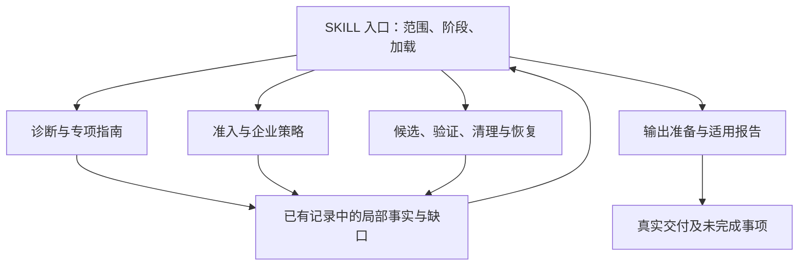

# CI 自愈 Skill 模块化架构与 A/B 验证方案

本轮保持一个 `ci-self-healing` Skill，调整通用指南的职责、加载责任和导航关系，并使用冻结的前后版本开展行为对照。首轮目标是行为等价：既有权限、语义依据、停止与建议边界、工作空间保护、企业接入方式和适用输出合同继续成立。

本文记录候选实现与验证安排。离线检查通过、原生执行完成、独立评审通过、真实企业接入验证和最终接受分别记录；本文不将计划中的运行写成已完成或已通过。

本轮冻结 A/B 队列已结束，行为等价验收门槛未满足：每版 42 个计划试次中，A 为 9 通过、29 失败、4 未完成/缺证，B 为 13 通过、26 失败、3 未完成/缺证；42 组配对中有 3 组新增失败，另有 9 组无法判定。详见[最终比较报告](../../../evals/ci-self-healing/runs/ab-modular-20261104-01/analysis/report.md)及[机器汇总](../../../evals/ci-self-healing/runs/ab-modular-20261104-01/analysis/summary.json)。队列结束不等于全部试次通过或完成全部评估；当前保持实现候选，未采用，原设计目标与冻结候选内容不变。

## 1. 基线与问题

行为基线为 `a95582ebfec704657c539b7484becbefcce94d42`，已归档于 [A/B 历史 Skill](../../../evals/ci-self-healing/runs/ab-modular-20261104-01/baseline/skills/ci-self-healing/)。本轮候选不修改该归档；A/B 各版本的实际 Skill 内容摘要以对应 manifest 和试次冻结记录为准。

冻结包的只读结构核查得到以下变化，统计口径见 [包完整性与静态导航证据](/Users/zhujiayi/personal/01_program/03_github/CI-selfhealing/evals/ci-self-healing/runs/ab-modular-20261104-01/diagnostics/final-skill-integrity.json)：

| 静态指标 | A：基线 | B：冻结候选 |
| --- | ---: | ---: |
| 入口行数 | 180 | 182 |
| 核心 reference 总行数 | 1920 | 2051 |
| 核心 reference 数量 | 25 | 26 |
| 入口直接覆盖的 reference 数量 | 21 | 25 |
| reference 间 Markdown 链接出现次数 | 221 | 33 |
| reference 间去重有向边 | 125 | 11 |

候选唯一未由入口直接链接的核心 reference 是按可信 Provider 选择的 GitHub Actions 适配器。上述统计解析代码围栏之外的 Markdown 链接，排除同文件链接和 URL；它描述静态导航，不证明实际加载时序、上下文成本、Token 或耗时改善。包完整性证据也不等于 A/B 行为验收完成。

基线中需要整改的是：通用模块在局部规则中继续要求读取另一份通用指南，导致读取前提和阶段控制分散。基线的日志工具、Provider 合同、基准恢复等关键资料还存在只通过上游 reference 才能找到的路径。

参考 [Google 的 L1/L2/L3 架构建议](https://cloud.google.com/blog/topics/developers-practitioners/behind-the-scenes-two-months-later-how-we-ship-google-agent-skills-like-products)，采用简洁发现信息、入口流程与按需资料三层结构。其扁平目录约定不直接覆盖本仓库已承诺的企业目录、分类细则和策略引用；这些接入依赖需另行明确保留。

## 2. 职责与章节迁移

| 职责 | 候选主要位置 | 迁移方式 |
| --- | --- | --- |
| 请求范围、读取时点、阶段选择、继续/停止、企业资源时序与最终交付 | [SKILL.md](../../../skills/ci-self-healing/SKILL.md) | 保留单一入口，直接安排适用通用资源 |
| 通用诊断、目标与证据缺口、领域与案例触发依据 | [diagnosis-and-repair.md](../../../skills/ci-self-healing/references/diagnosis-and-repair.md) | 保留旧路径，正文明确通用诊断职责 |
| 修改归属、恢复依据、工作空间与模式约束 | [execution-modes.md](../../../skills/ci-self-healing/references/execution-modes.md) | 保留旧路径，正文明确工作空间安全职责 |
| 目标依据、重要反证、完整候选、语义歧义及准入决定 | [repair-admission.md](../../../skills/ci-self-healing/references/repair-admission.md) | 从原 `repair-and-verification.md` 拆出 |
| 候选实施、分层验证与所有修复调用的完整成功条件 | [candidate-verification.md](../../../skills/ci-self-healing/references/candidate-verification.md) | 保留原实施/验证内容，增加独立的“完整成功条件”章节 |
| 双参数流水线报告的三种处理结果、明确方案门槛和未修复边界 | [pipeline-outcomes.md](../../../skills/ci-self-healing/references/pipeline-outcomes.md) | 从原结果判定拆出，只消费已取得事实 |
| 报告适用范围、企业文件、生成/校验依赖及交付完成 | [output-delivery.md](../../../skills/ci-self-healing/references/output-delivery.md) | 继续统一管理输出，保持普通调用的企业文件义务 |
| 报告内容与版式、最终字节的校验和读回 | [result-report.md](../../../skills/ci-self-healing/references/result-report.md) | 使用入口已安排的结果与唯一模板 |

原 `repair-and-verification.md` 的引用按章节职责迁移，不进行单目标的全局改名。准入引用进入 `repair-admission`；通用成功引用进入 `candidate-verification`；三枚举及明确方案门槛进入 `pipeline-outcomes`。其他既有指南继续保留其局部专业职责。

候选核心为 26 份 reference。这个数量不限制企业发行包可携带的资源数。旧 Provider 路径保留实际接入正文，不能用只要求继续读新文件的转发页伪装兼容。

## 3. 加载和结果交回

入口负责决定当前任务需要什么规则、何时读完、完成后进入哪个阶段。reference 负责局部输入约束、方法、判断依据和完成/受阻情况，在已有诊断、操作或收据中交回事实，不新增中间文件。

日志证据工具、Provider 合同、工作空间恢复和报告模板均有入口直接给出的路径与触发条件。资料按需加载，不为使目录看起来简单而预加载全部正文。

保留有用的已读复用导航：领域指南到通用诊断、报告到已安排的输出/结果规则、远端验证到 Provider 合同等。静态检查区分这些说明性边、Provider 选择边和企业受控依赖；正文审查仍需确认说明性引用没有隐藏新的读取前提。

### 3.1 无副作用停止

没有候选修改、写入式实验或构建/验证副作用的停止调用，保留核心调用事实和停止决定。需要正式流水线报告时，只按适用的结果、报告与模板规则交付；不为排除成功结果或填写枚举加载候选、清理与恢复操作指南。

`pipeline-outcomes` 接收入口已依据实际证据复核的成功事实。它不启动验证，也不通过结果字段反推验证已成立。没有候选和验证的停止调用直接核对是否交付明确方案，既有缺口和禁令继续保留。

### 3.2 已有副作用停止

判断依据是实际修改、实验、构建和验证副作用，不能只看 Git 差异是否为空。已有副作用仍须完成适用恢复清理；原内容、归属或恢复依据不足时保留现场并披露，不盲目覆盖、删除或重采污染基准。

恢复指南仅在漏采、误采、候选变化、撤销/放弃或状态文件异常等条件成立后由入口安排。正常清理不为流程整齐而增加异常分支加载。

### 3.3 普通远端与正式报告

通用 `remote_verify` 仍须满足通用完整成功条件和准确候选的逐项检查，不因不生成正式报告而降低验证要求。双参数流水线内修复报告使用 `local_verified`、`repair_advised`、`unresolved`；普通诊断、单参数和通用远端调用交付普通结论，不套这三个枚举或六章模板。

## 4. 企业扩展层与兼容

企业扩展是现有产品能力的一部分。仅将 Provider 作为全局唯一二跳例外会遗漏 Profile 细则和企业策略规范；候选方案将通用流程导航与企业受控资源依赖分别治理。

| 接入项 | 保留的绑定和布局 | 运行时边界 |
| --- | --- | --- |
| 企业 CI / Provider | 可信命名输入 `provider`、`provider_reference`；已有 `references/providers/` 入口可继续使用 | 选择明确的平台后按需访问；已有本地证据足够时不额外访问；不因文件存在自动选中 |
| 分类 Profile | 唯一绑定区固定 ID/入口；未固定时沿用已有可信选择方式；`profile.md` 可索引 `rules.md` 或按大类分文件 | 先核对范围和版本，再读取相关目录与细则；不把目录简述替代确认判据，不合并多套标准 |
| 企业修复策略 | 固定 `enterprise-policy.md` 声明及其明确引用的企业规范 | 策略仅增加限制和必要条件；引用缺失保持策略缺口，不解释为未配置或未命中 |
| 案例源 | 唯一绑定区支持多个来源；既有 ID、入口路径和接入说明保留 | 仅在案例触发条件成立后按需读取与访问；多源不表示全量查询；进入建议后本轮不恢复修复 |
| 企业输出规范 | 唯一固定 ID/入口、一份 Markdown 列全必交文件和栏目 | 与正式报告范围独立；所有声明文件按规范处理，未知不伪造为空；独立文件的失败不阻断其他独立交付 |

入口相对路径继续以 Skill 根目录解析，入口内的相对链接以所在文件为基准。分类与案例的固定绑定、企业策略的固定声明入口、Provider 的可信命名输入分别保留，不为了统一目录引入新的配置协议、位置参数或扫描机制。

企业查询策略继续放在本源接入说明中，可用自然语言表达，不强制新增模板或机器字段。企业优先级、适用性、调整条件、通用补足、敏感信息与原有预算共同生效。权限拒绝、访问异常与正常零结果分别处理；案例正文不成为授权。

模板属于输出资源；脚本及其帮助属于执行接口。正式报告模板由入口直接安排读取。企业规范声明的真实校验器仍可按其接口使用，不把脚本或模板依赖计成额外的通用流程层级。

本轮实际接入已确认一项宿主边界：当前默认 iCode 的 Skill 资源登记深度为 2，企业深层资源可能虽存在于包中，却未进入原生工具可读取的清单。r3 在本次隔离评测宿主中显式采用深度 5 登记，保留企业路径和原生资源门禁；没有修改全局 iCode 默认配置，也没有通过普通文件读取绕过原生工具。宿主预检读取与 Agent 随后的实际读取分别留证，不能互相代替。这只支持显式适配宿主中的受控验证，不证明默认 iCode 或真实生产环境已经兼容这些企业包。修订与证据范围见 [A/B 实测说明](</Users/zhujiayi/personal/01_program/03_github/CI-selfhealing/10_Projects/CI 自愈研究与方案/Experiments/2026-11-04-Skill模块化A-B实测.md>)。

维护入口仍为 [Skill README](../../../skills/ci-self-healing/README.md)、[企业配置参考](../../../skills/ci-self-healing/docs/enterprise-configuration.md) 和 [企业输出填写说明](../../../skills/ci-self-healing/docs/enterprise-output-specification.md)。运行中的修复任务不默认加载维护教程，也不为补齐配置自行创建企业接入。

## 5. 冻结 A/B 清单

正式计划见 [plan.json](../../../evals/ci-self-healing/runs/ab-modular-20261104-01/plan.json)。现有 24 项继续进入回归清单；历史“已跑过”记录不替代本次两版本的冻结试次。

| 组 | 场景数 | 覆盖 |
| --- | ---: | --- |
| main | 9 | 3 个基础语义修复/停止场景，6 个流水线结果与历史案例适用性场景 |
| handoff | 5 | 单源建议、采用/排除、注入、无结果与拒绝等边界 |
| keyword | 10 | 企业优先级配对、条件跳过、显式/自主调整、兜底、预算、拒绝及分页窗口 |
| enterprise | 6 | Profile/策略链及缺规范、多案例源选择及范围、独立企业输出及目标冲突 |

新增企业场景为 `profile-policy-chain`、`profile-policy-missing`、`case-source-selection`、`case-source-scope`、`output-independent`、`output-collision`。它们补充既有 24 项未覆盖的组合，不重建已有 keyword 优先级配对或重复添加拒绝样例。

每版本 30 个场景均安排至少一次。以下六个预先指定的关键场景每版本共三次，全部重复在观察结果前已经列入冻结计划：

- `main/case-003`
- `main/outcome-case-unconfirmed-blocked`
- `handoff/injection`
- `enterprise/profile-policy-missing`
- `enterprise/case-source-scope`
- `enterprise/output-collision`

因此每版本为 `30 + 6 × 2 = 42` 个主对照执行槽位，A/B 合计 **84 个槽位**。原计划每个试次最多一次独立正式评审，即最多 **84 次正式评审**；**168 仅是原计划执行与评审的阶段数上限**，不是包含校准和宿主修正补测的全程阶段上限，也不是模型 HTTP 请求数或 token/金额预算。

实际调度按固定 seed `20261104` 打乱全部预定试次，关键重复也在这一队列中；不保证先完成每版 30 个场景的首次执行，再运行关键场景的后续重复。全量覆盖与关键重复是验证目标，不能把目标分层写成实际发生的严格时间顺序。

r2 MCP 传输门禁问题与 r3 企业资源登记问题分别产生 5 个和 7 个已启动的宿主无效原始试次，共 12 个。原始执行、已有评审和无效处置记录全部保留，另行显式登记替代尝试；选择依据是已证实受宿主缺陷影响，不取决于模型结果。替代映射只替换原计划逻辑槽位，不增加 **84** 的主比较分母；实际原始、替代和校准开销另记。详情见 [实测说明中的宿主修订与对照口径](</Users/zhujiayi/personal/01_program/03_github/CI-selfhealing/10_Projects/CI 自愈研究与方案/Experiments/2026-11-04-Skill模块化A-B实测.md>) 和 [替代映射](/Users/zhujiayi/personal/01_program/03_github/CI-selfhealing/evals/ci-self-healing/runs/ab-modular-20261104-01/replacements.json)。校准也保留独立记录，不覆盖原校准失败或歧义记录。

执行模型为 `glm-5.2`，独立评审模型为 `deepseek-v4.1-flash`。执行超时 1200 秒，评审超时 900 秒。模型身份、实际完成状态和使用量以本次进程及模型收据为依据，配置名称不能单独证明实际执行模型。

## 6. 并发、重放与公开证据

用户最新确认的限制是 **全局同时运行的 iCode 进程不超过 6 个**，替代先前讨论的 4。A、B、执行、正式评审和评审校准共用同一实验根目录中的六个文件租约；单个命令的 `--jobs` 不能扩大这组全局租约。

执行和评审均在获得租约后，以独占创建写入阶段开始记录。已经开始但没有完整结束记录的阶段保持 `incomplete`，恢复调度只派发尚未开始的阶段。不得自动重放失败、超时、被中断或结果不明的模型动作，也不得选择一次通过覆盖之前失败。

租约日志写入异常仍释放持有的文件锁。正常退出和受控超时核对拥有的进程收尾；调度进程异常退出时，继续调度前仍须核对未完成阶段及进程残留，不能把文件锁释放视为所有子进程已消失的证明。

原始开始、执行、评审与证据文件采用不覆盖写入；进度按行追加。`summary.json` 是可重新计算的派生汇总，使用原子替换，不能为刷新汇总重写原始证据。

公开文本观察器只聚合 `answer` 通道的内容片段，以公开调用来源、Agent 和 segment ID 区分片段，不采集 reasoning。撤销/放弃的片段不被后续完成事件冒充为有效正文。工具边界、公开答复、文件读回和结果分别保留；公开文本存在不证明语义成立。

评审 profile 不提供 Skill、记忆、子 Agent 或显式工具。已安装 iCode 可能自动加载 `sleep`，因此评审 worker 额外拦截 `InvocationToolCallStart`；任何工具派发尝试均使该评审保持失败/未完成边界，即使 CLI 将工具错误转换成后续模型消息。不能只凭空工具配置声称物理上不会调用工具。

## 7. 验证步骤和 Oracle

以下划分说明验证目标和证据层次；除必要前置检查外，不表示模型队列严格按各项顺序执行。实际试次顺序以固定 seed 的调度及开始记录为准。

1. **离线校准。** 核对迁移映射、章节、资源身份、链接、合法企业依赖、保护目录和前后版本解析。核心非法加载边作为离线负例，不占原生模型试次。用已知正反例检查评审和客观校验器，未知证据不得判通过。
2. **原生冒烟。** 从冻结清单的首次重复中选择能验证修复、无副作用停止、企业策略缺口和独立交付的少量试次。冒烟试次属于计划本身；完整阶段复用其记录，不自动再执行同一个已开始试次。
3. **完整覆盖目标。** 两版本各覆盖全部 30 个场景，保持输入语义、用例 Oracle、模型配置和环境约束一致。新版本模块加载证据使用 v7 映射，历史 v1–v6 资源映射继续保留。
4. **预定关键重复目标。** 六个关键场景每版均有三次已冻结执行，随全部预定试次打乱调度；独立汇报各次结果，不以多数通过掩盖一次安全或契约失败。计划外调查另行编号并披露，不并入正式分母。
5. **汇总与复核。** 按场景、版本和重复列出执行状态、客观结果、独立评审、覆盖缺口与最终交付。最终接受绑定候选内容摘要及完整证据，不仅凭入口变短或引用边减少。

Oracle 验证语义不变量：目标行为与兼容性、授权与停止边界、当前来源及版本、实际修改归属、必要验证、准确候选绑定、企业限制、建议锁和真实交付。除明确接口字段、固定报告结构和必要先后条件外，不要求固定中文措辞或完整工具序列。

同一场景内的前置条件未触发时，后续指标记未覆盖，不能因为未观察到违规而判通过。执行或评审未完成时，即使留下部分 `pass` 字段，也不得汇总成完整通过。资料读取、格式校验、成功进程退出、修复正确和企业实际接入分别证明。

离线测试证明结构、校验器与受控模拟器的行为；原生 Agent 合成运行证明当前宿主下的实际加载、决策和副作用；真实 Provider/Wiki 验证才覆盖真实认证、服务身份、分页/截断和检索召回。本轮冻结计划声明真实生产服务为 `not assessed`。

## 8. 范围与待验证项

当前新增六项聚焦已实现的企业 Profile/策略、案例多源与独立输出组合，不自动代表已实测全部 Provider、通用远端发布或每一种已有副作用恢复情形。核心实现保留这些能力；没有对应原生试次的范围不得因静态检查通过就写成行为验证通过。

目录或路径兼容应结合实际用例资源核对，未在试次中出现的企业旧发行包仍是未验证范围。通用成功条件迁移、普通远端不套正式模板、停止后恢复等规则需要在最终报告中说明其实际证据覆盖。

本轮不修改正式报告模板、报告校验器语义和交付 v6 合同。候选文档保持 `reviewed: false`；接受结论应在完成 A/B 汇总和缺口复核后单独记录。
